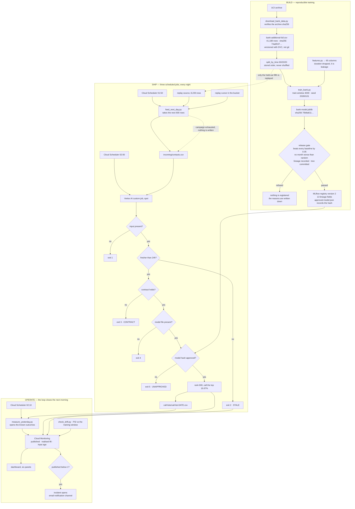

# ITCS355 Capstone, call-list ranker

Ranks a bank's customer contact list so agents call the most promising people first,
published as a nightly batch to a schedule on Google Cloud. Built to demonstrate an
operational system, not a model.

**The model appeared to lose to a single column, and the interesting part is that the
measurement was wrong.** Sorting customers by the interbank rate, a number identical for
everyone contacted in the same week, beat the model when a whole year of calls was ranked
in one go. It cannot beat anything inside one night's export, which is the only thing the
job ever ranks. Fixing what was measured, and retraining on a recent window, changed the
gate's verdict from refuse to pass. Both runs are in the repository.

---

## The thing this project is actually about

An overnight customer export fails to arrive. Yesterday's file is still in the bucket. The
job reads it, scores it, and publishes a call list with the right number of rows, a normal
score distribution, and no error anywhere. The dashboard stays green.

In the morning, agents call the people they called yesterday.

Nothing in an ordinary pipeline notices, because nothing in an ordinary pipeline asks *when*
the data is from. It asks whether the read succeeded, and the read succeeded.

**The control is a freshness gate that publishes nothing rather than something plausible.**
A missing call list is an obvious problem somebody fixes in ten minutes. A wrong one is
worked through for a day.

Demonstrated, both ways, on the same file:

| | Without the gate | With the gate |
|---|---|---|
| Exit code | 0 | 2 |
| Published | **500 customers** | nothing |
| Score range | 0.147 to 0.447, median 0.219 | none, nothing was scored |
| Errors | none | none |
| Age of input | 26 hours | 26 hours |

Full write-up: [`reports/stale-input-demo.md`](reports/stale-input-demo.md).
Reproduce it: `python scripts/demo_stale_input.py`.

---

The one-page proposal from M2 is [`PROPOSAL.md`](PROPOSAL.md). Its claims and figures are
the ones submitted, with only the punctuation tidied since.

---

## The workflow, end to end

Three phases. The dotted arrow is the one the project is about: when the feeder stops, the
export is never rewritten, it ages past the freshness limit, and the scorer refuses.



**Reading the refusal paths.** The nightly job has six ways out, and **five of them publish
nothing**, exit 1 through 5, one per gate, in the order the code checks them.
Each writes its reason to `reports/nightly-metrics.json`, prints it to Cloud Logging, and
emits `published = 0`, which is the condition the alert watches, so a refusal raises an
incident rather than passing silently.

**Where it actually ran.** The dotted path is not hypothetical. The feeder wrote its last
export at `2026-10-02 18:52Z`, reported the held-out period exhausted on its next run, and
never rewrote the file. The scorer refused on staleness for **seven consecutive nights**,
with `input_age_hours` climbing 24.15 to 168.17, and the incident opened by itself at
02:05:34 on 4 October. Logs and metric series:
[`reports/incident-2026-10-04.md`](reports/incident-2026-10-04.md).

## Reproduce everything

```bash
conda create -n itcs355-capstone python=3.11 -y
conda activate itcs355-capstone
pip install -r requirements.txt

python scripts/download_bank_data.py      # or: dvc pull
pytest -q                                 # 76 tests
python scripts/train_bank.py              # trains and scores against baselines
python scripts/register_bank_model.py     # asks the gate -- see the warning below
python scripts/check_drift.py             # 6 of 7 columns alerting
python scripts/demo_stale_input.py        # the failure, with and without the gate
```

**`register_bank_model.py` rewrites `reports/approved-model.json`.** It records the hash
of the model on *your* disk as the approved one, and numbers the registry version from
*your* local MLflow, which starts empty. Run it on a fresh clone and the repository's
approval record stops naming the model this project actually approved --
`70b8a611... version 2` becomes whatever you just trained, version 1. Run it to see the
gate work, then `git checkout -- reports/approved-model.json` to put the real approval
back. Do not commit the rewritten file.

This also only reproduces under the pinned environment. The hash is of the serialised
bytes, and joblib writes different bytes under a different Python: the same model,
making the same predictions, hashes differently on 3.14 than on 3.11. That is the
content-addressing working as intended, and it is why the environment is pinned.

An environment of its own matters here rather than being a formality: the release gate
approved a model by its sha256, and the nightly job refuses any model whose bytes differ. A
stray scikit-learn version retrains to different bytes and the job correctly refuses to
publish. `requirements.txt` is pinned with hashes so that cannot happen quietly, and
`requirements-dev.txt` pins the same set plus the linter so CI installs what the image
installs rather than resolving whatever is newest that morning.

Nothing above needs cloud credentials. `dvc pull` needs access to the GCS remote, and the
download script is the alternative and produces a byte-identical file.

---

## Data

| | |
|---|---|
| Source | UCI Bank Marketing, `bank-additional-full` variant |
| Rows | 41,188 · 20 input columns |
| Period | May 2008 to November 2010, in stored order |
| Licence | **CC BY 4.0**. Moro, Rita & Cortez (2014), DOI 10.24432/C5K306 |
| Versioning | DVC, with the SHA-256 recorded in `data/bank/dataset.json` |

**Which variant matters.** The commonly used `bank-full.csv` has 45,211 rows and no
macroeconomic columns. This one carries the Euribor rate, employment variation and price
indices recorded at call time, and because the campaign ran in time order straight through
the financial crisis, those columns contain a real distribution shift rather than a
simulated one.

| | Start of campaign | End |
|---|--:|--:|
| Euribor 3-month | 4.86 | 0.80 |
| Subscription rate | 2.8% | 45.9% |

---

## The trap that looks fine

Splitting this dataset at random hides the entire shift:

| Split method | First half | Second half |
|---|--:|--:|
| Random 50/50 | 11.4% | 11.1% |
| **Time-ordered 50/50** | **4.7%** | **17.9%** |

The wrong method produces the reassuring number. So the prohibition is a test, not a
comment: `tests/bank/test_splits.py::test_the_time_split_exposes_the_distribution_shift`
asserts the *presence* of a difference, which is backwards on purpose. On this file,
halves that look alike mean somebody shuffled.

Two more guarded the same way:

- **`duration`** correlates 0.405 with the outcome and is the most predictive column. It
  records how long the call lasted, which is unknown when the list is built. Including it
  appears to lift 1.34× → 2.86× within month, all of it unavailable in
  production.
- **`pdays` uses 999** for "never previously contacted", in 96.3% of rows. Split into a flag
  and a day count before the model sees it.

---

## Results, and the measurement that was wrong

The first version of this project reported these numbers, and the gate refused the model:

| Ranking, whole test period at once | Subscriptions in top 500 | Lift |
|---|--:|--:|
| Call in file order | 32 | 0.21× |
| This model | 207 | 1.34× |
| **Sort by `euribor3m` alone** | **278** | **1.80×** |

```
GATE FAIL
  - lift 1.34 does not clear the best baseline (euribor3m, 1.80)
    by the required 0.05; it needs 1.85
```

**One column with no per-customer information was beating the model.** `euribor3m` is the
interbank rate, identical for everyone contacted in the same week. It cannot tell one
customer from another. That should stop work, not prompt a retrain.

It won because the measurement let it answer a different question. Ranking 8,239 rows that
span months by `-euribor3m` sorts them, near enough, **by date**, and the late months are
when people subscribed. The deployed job never gets that chance: it ranks one export, whose
customers were all contacted at about the same time.

Measured the way the job actually runs, inside one contact month:

| Ranking, within one month | Lift | Worst month |
|---|--:|--:|
| Call in file order | 0.81× | 0.64× |
| Sort by `euribor3m` alone | 0.96× | 0.41× |
| **This model** | **1.34×** | **1.25×** |
| With `duration` (leaky, never registered) | 2.86× | 1.33× |

The baseline at 0.96× is not a strong opponent narrowly beaten. It is **no better than
calling people in no particular order**, which is what a column that is constant inside a
batch should be.

A second, independent fix: the model now trains on the most recent 4,000 rows rather than
all 24,712, because the campaign spans a financial crisis and older rows describe a
different world. The window size was chosen on the validation period. That change alone
raises even the old whole-period score from 1.34× to 1.97×, which clears the old gate too.
The model was undertrained *and* the measurement was wrong.

```
candidate  within month: lift 1.34x across 13 months, worst month 1.25x
GATE PASS
```

Registered as `bank-call-list-ranker`. **Version 1** carried 11 lineage fields. The model
was then retrained at a later commit and registered as **version 2** with 13, adding
`model_sha256` and `git_tree_clean`, the two fields that let the nightly job check which
bytes it is about to serve. Both versions are written out of the registry itself by
`scripts/describe_registry.py`: [`reports/bank-registry.md`](reports/bank-registry.md).

**Version 2 is the approved one**, and `reports/approved-model.json` names it by hash. Both
versions report the same `metric_lift` of 1.3396 from the same seed and the same dataset
hash, which is the reproducibility claim being exercised rather than asserted. Full working,
including a hypothesis that was tested and turned out wrong:
[`reports/bank-export-evaluation.md`](reports/bank-export-evaluation.md).

**The measured limit.** On the validation period, the crisis onset, the same model scores
1.07× within month and falls below 1.0 in two of its four months. This model's skill does
not survive a regime break. That is why the drift monitor exists, and it is in the
[model card](reports/model-card.md) as a known limit rather than a footnote.

---

## Monitoring

`python scripts/check_drift.py` finds 6 of 7 watched columns above the PSI threshold of 0.20.

**This run is expected to alert.** A drift check finding nothing here would mean the
detector was broken, not that the world was calm.

One limit carried over from Lab 4: **PSI measures how far the input moved, not how much the
model minds.** A shift scoring 0.383 cost 0.0100 ROC AUC there, while one scoring 0.2627
cost 0.0167. PSI opens an investigation. It does not rank incidents.

---

## Deployment

The nightly job ran on Google Cloud, on a schedule, reporting to a dashboard with an alert
that fired on a real refusal. It ran for nineteen nights and was **torn down on 12 October**,
because the course requires it: `reports/teardown-check.json` lists nothing still running.
The console is empty, and the evidence is in `reports/`.

| | |
|---|---|
| Schedule | Cloud Scheduler `itcs355-capstone-nightly`, `0 2 * * *` Asia/Bangkok |
| Compute | Vertex AI custom job, `e2-standard-4`, spot |
| Image | `itcs355-capstone@sha256:e55bc7bd…c166dd6`, base pinned by digest, non-root |
| Identity | `itcs355-train`, which can read and write storage and submit jobs, nothing else |
| Output | `gs://itcs355-6688010/capstone/call-lists/call-list-YYYY-MM-DD.csv` |
| Alert | fires when `published < 1`, i.e. when a run **refused** rather than when it crashed |

The alert was proved rather than configured: an export carrying an unknown job category was
uploaded, the contract refused it, and the `published` series went 1 to 0. Working:
[`reports/deployment.md`](reports/deployment.md).

**Then it happened for real.** Twelve nights later the replay reached the end of the held-out
period, the feeder had nothing to publish, the export aged past 24 hours, and the scoring job
refused on staleness for seven consecutive nights, unattended, with `input_age_hours` climbing
24.15 → 48.27 → 72.15 → 96.15 → 120.16 → 144.25 → 168.17 and an incident open in Cloud
Monitoring from 4 October 02:05:34 that was still open eight days later. Nobody staged it and
nobody intervened. Logs, metric series and the limits it exposes:
[`reports/incident-2026-10-04.md`](reports/incident-2026-10-04.md).

That report also explains why Vertex shows **twenty-one FAILED jobs** after thirty-six
SUCCEEDED ones: a refusal exits non-zero on purpose, so Vertex cannot tell a refusal from a
crash. The job state is not the signal. The metric is.

---

## "The data is not live. How does it run day by day?"

The campaign is **replayed**. A separate scheduled job publishes the next slice of the
held-out period every night at 01:50, and the scoring job treats it as today's export at
02:00. The rows are real, and only the calendar is synthetic.

Two jobs rather than one, on purpose: **if the feeder fails, nothing rewrites the export, it
ages past 24 hours, and the scorer refuses.** The failure the project is built around then
happens for real instead of being simulated by editing a timestamp.

And the replay can do one thing a live system cannot. The campaign finished in 2010, so the
outcomes are already known, and last night's list is scored **ten minutes after it is
published** rather than weeks later:

```
call list for 2026-10-02
  export:  439 customers, 205 subscribed (46.7%)
  called:  73 customers, 51 subscribed (69.9%)
  realised lift: 1.50x  (+16.9 subscriptions against calling the same 73 at random)
```

A live campaign waits weeks for those labels. Lab 3 hit exactly that wall, which is why its
canary had to use a label-free proxy too weak to see anything.

**The replay has since been run to the end**: fourteen nights, twelve of them on the schedule
in the cloud, at **mean realised lift 1.294× (sd 0.260, standard error 0.069)** against the
gate's estimate of 1.34×. The difference is 0.046, about two thirds of one standard error,
so the held-out prediction and what the system actually did cannot be told apart at fourteen
nights. One of those nights came in at **0.577×**, worse than calling at random, and it is in
the series rather than left out of it.

Then the held-out period ran out, and the system did what it was designed to do without
anyone watching, as described below. Full design, including why the replay stops rather than looping:
[`reports/replay.md`](reports/replay.md).

---

## Cost

| Serving pattern | THB / month |
|---|--:|
| Always-on managed endpoint | ~6,400 |
| **Three nightly batch jobs on spot (chosen)** | **~7.70** |

5.79 of that is compute, three jobs at 1.93, and the rest is storage and the container
registry. Both figures in the table are totals, so they compare.

Three jobs rather than one step: the feeder, the scorer and the measurement are separate so
that a feeder failure leaves a stale input for the gate to refuse instead of failing the
whole run. That separation costs about 3.9 THB a month.

An endpoint bills 8.889 THB/hour whether or not anything calls it, to serve 0.48 predictions
per second that nobody waits for. Full working: [`reports/cost-report.md`](reports/cost-report.md).

---

## Layout

```
src/bank/          contract, splits, features, evaluate, gate, freshness, monitoring,
                   cloud (object storage and metrics)
Dockerfile         the image the scheduled job runs, base pinned by digest
scripts/           download, train, register, score_nightly, check_drift,
                   feed_next_day and measure_yesterday (the replay), demos
tests/             76 tests
reports/           training, drift, gate decision, cost, model card, the demo,
                   deployment, the replay, the 4 October incident, teardown proof
```

The reasoning behind each step, meaning what it is, why it is needed, what breaks without
it, and how the choice was checked, is recorded in the project's commit messages. The measured
evidence for every claim above is in `reports/`.

---

## Four bugs the guards caught, in the code that guards

Each of these was found by something in this repository rather than by review, and each was
silent:

1. **The drift detector reported a column that moved completely as perfectly stable.**
   `nr.employed` has three distinct values in the training window. Quantile edges collapsed
   to two, both were overwritten with infinities, and every row landed in one bucket. PSI
   read 0.0000 for a column whose reference and current ranges do not even overlap. It now
   reads 9.89.
2. **The lineage field `data_version` came back empty**, because the DVC pointer writes
   `- md5:` under a YAML list item and the parser matched only `md5:`. The gate refused the
   registration and the bug was fixed instead of shipped.
3. **The model lost to a single column**, which nobody would have known without measuring a
   baseline first.
4. **An empty export crashed the nightly job**, reaching the model and raising a library
   error about array shapes, a stack trace saying nothing about the export having failed,
   arriving for whoever is on call. It is now a contract rule with a readable refusal.

---

## What is not done

- **The data is a fixed historical snapshot, and the system is not live.** This makes the
  pipeline strongly reproducible, because one commit names one dataset by hash and a fresh clone
  plus `dvc pull` returns it byte-identically. It also means two things worth saying plainly:
  the nightly job scores a slice of the same 2010 file rather than a genuinely new export,
  and the drift detected is a real shift that happened in 2008 to 2010 being **replayed**,
  not one observed as it happens. The shift is real data rather than injected noise, which is
  why this dataset was chosen. It is still not live.
- **No billing export**, so the cost figures are rebuilt from Lab 5's measured rates
  and this project's own job durations rather than read off an invoice. The deployment
  itself is real. The accounting of it is measurement.
- **The registry is a local SQLite file**, not a hosted one, so "registered" means
  registered on this machine. Its contents are written out to
  [`reports/bank-registry.md`](reports/bank-registry.md) so the claim can be checked
  without it.
- **No group-fairness measurement.** Noted in the [model card](reports/model-card.md)
  rather than omitted.
- **The alert is delivered but not routed.** It reaches one email address, with no rotation,
  no severity on the policy and nothing that pages anybody. The evidence for this limit is in
  the project's own data: the incident of 4 October stayed open for seven nights, so the
  honest answer to "who would have seen this at 3am" is nobody. Detection and delivery are
  built and proved. Getting an alert to a human who is awake is not.
- **The replay is finite, and it has been used up.** Fourteen nights of held-out rows are
  gone, the cursor is marked exhausted and the scheduled jobs are paused. Restarting means
  extending the source, not resetting the cursor, because a reset would replay rows the model was
  trained on and make every realised-lift number after it meaningless.
